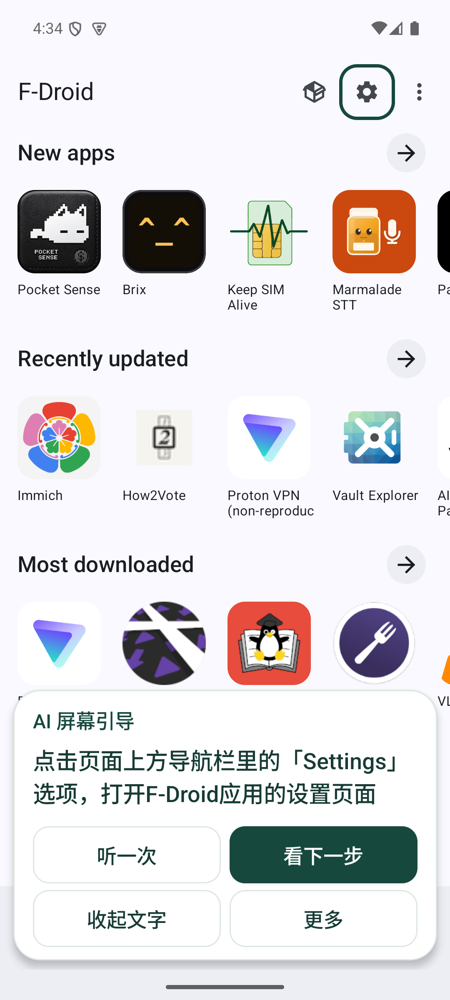
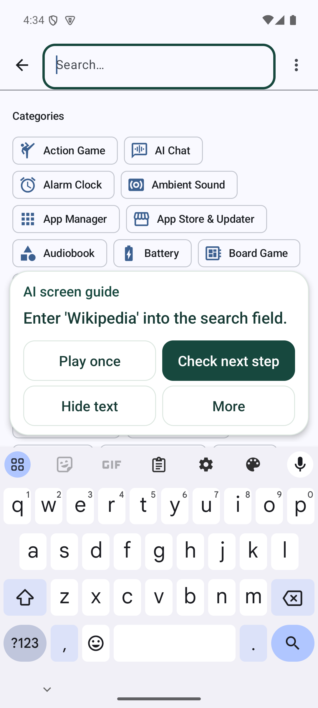
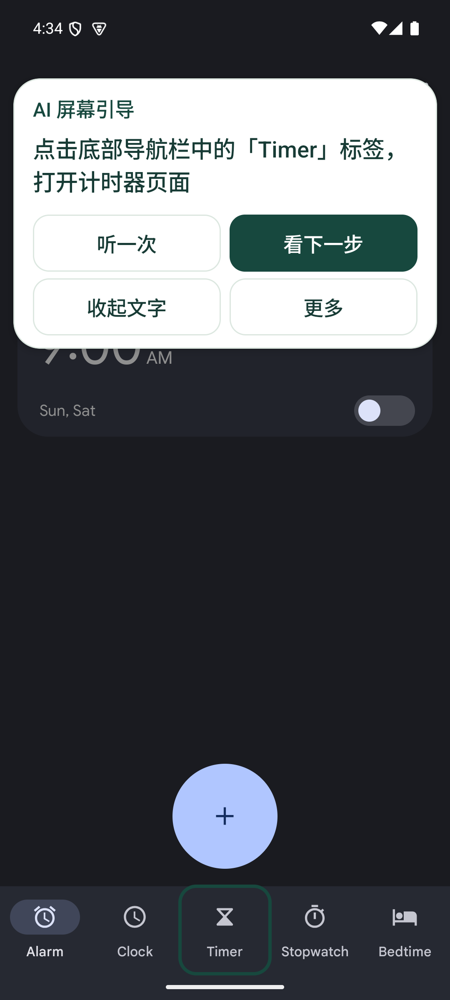

# Digital Handrail | HKU4SDG

**You take the action. We help you find the next step.**

Digital Handrail is a native Android app for people who need help using their phone. Users speak or type a goal, choose a reviewed task or start AI screen guidance for an app, and follow one highlighted step at a time. Instructions can be read, collapsed, or spoken. Users tap, drag, and confirm the result themselves.

Users install one **guide APK**. The **demo-target** module is an internal test fixture, not a second product or an installation requirement.

**Download: [Android 0.2.0 test APK](https://github.com/randyxian08/hack4sdg/releases/download/v0.2.0/digital-handrail-0.2.0-debug.apk) · [Release notes and checksums](https://github.com/randyxian08/hack4sdg/releases/tag/v0.2.0).** Requires Android 8.0 or later. See the [phone testing guide](docs/phone-testing.md).

This is a development-signed test build. Phones can try local font-size and brightness guidance. **Cloud AI screen guidance and cloud speech currently require the Debug emulator and a computer-hosted proxy; they do not run independently on ordinary phones.**

> **0.2.0:** [AI screen guidance](docs/screen-guidance.md) sends visible controls from a user-selected app to the model after consent, with an optional window screenshot. Each step must refer to a real control. Screen changes remove the old highlight and trigger a new assessment. This does not require a predefined flow for every app, but still depends on readable accessibility controls and is not universal app support.

> **0.1.3:** Updated Volcano TTS response handling, added AI/speech startup and live-provider checks, and made model versus local matching explicit. See [AI and trilingual speech](docs/ai-voice-demo-2026-10-17.md).

> For a competition presentation, start with the [GenAI pitch brief](docs/pitch-genai.md). It covers the product story, six technical assessment questions, evidence, and missing material. It reflects 0.2.0; the Feishu update dated October 17 describes the older 0.1.3 scope.

> **0.1.2:** Added preview avoidance, direct replay, explicit end receipts, brightness-goal choices, and local service diagnostics. See the [reliability changes](docs/guide-reliability-2026-10-09.md) for evidence and unresolved issues.

> The original four-task baseline is [PR #6](https://github.com/randyxian08/hack4sdg/pull/6). Version 0.1.1 introduced experimental phone guidance for font size and brightness; installation, Chinese-system screenshots, and limits are in the [phone guide](docs/phone-testing.md).

## Current capabilities

**AI screen guidance** starts from “Help with this app's screen” on the home screen. Users select an app and a goal, then separately consent to page processing. Written and spoken languages are independent. Replay, manual refresh, pause, goal refinement, and explicit completion confirmation are available. Session goals and page content are not added to practice history. See the [data flow and limitations](docs/screen-guidance.md).

The **four reviewed flows** remain available and are evaluated separately:

The reviewed demo environment is an **Android 15 / API 35, English-system, sdk_gphone64_arm64 emulator**. Since 0.1.1, font and brightness guidance can also be tried on **Android 8–16 / API 26–36 in Chinese or English**, with a “Try” availability status. Phone guidance highlights only a uniquely identified current control and falls back to text when it cannot verify one. Admission to a flow is not device acceptance. Chrome and Maps still require the reviewed emulator and exact app versions.

| Task | User action | Detected result |
|---|---|---|
| Make text larger | Open Display size and text in real system Settings and drag Font size | System font_scale increases; the user then confirms readability |
| Make the screen brighter | Choose manual or adaptive brightness; manually drag the real Settings slider when applicable | Manual value increases, then confirmation; adaptive-switch logic is implemented but only synthetically tested because this emulator lacks the switch |
| Bookmark a senior-services webpage | Use the bookmark controls on the specified GovHK page in Chrome **124.0.6367.219** | Edit bookmark appears; the user confirms. Existing bookmarks can also be checked |
| Find a library address | Expand the Hong Kong Central Library place card in Google Maps **11.129.0103** | The specified address row appears; the user confirms seeing it |

The Maps task displays an address, not route navigation. Users perform every action. Unknown pages lose their highlights; AI does not tap, type, or submit for the user.

### Implemented experience

- **Three independent language settings:** input, interface/AI text, and speech each support Mandarin, Cantonese, and English.
- **Three help levels:** full guidance, light hints, and trying independently with help on demand.
- **Goal-first home screen:** speak or type a need, then confirm the matched task. Four tasks remain as shortcuts; unsupported requests are explained.
- **Floating guidance:** a current instruction with replay and more options; collapsed controls keep replay and text easy to find. The same window is reused while scrolling within a step. Placement avoids controls and font previews; arrows explain swipe direction. More options include pause, move, mute, languages, and ending with a cancel path. Required safety and result-confirmation content cannot be hidden.
- **Onboarding:** choose Simplified Chinese, Traditional Chinese, or English, app text size, input language, and voice language; then review permissions and a highlight practice. Permissions can be deferred. Script choice does not change the selected language.
- **Setup and recovery:** keep the chosen task and help level, preserve one attempt across pause/resume, and recheck the screen before continuing. Restricted-settings help and app-information access are available. Diagnostics distinguish permission, connection, and task state and can be copied explicitly.
- **Confirmation and history:** font and manual-brightness results allow further adjustment. Confirmation or exit produces a receipt with return/stay choices. Up to 20 deletable local attempts distinguish confirmed completion from an unconfirmed end.
- **Intent matching and speech:** fixed-mode AI chooses only a reviewed task, clarification, or rejection. Screen mode separately analyzes the current page. The Debug emulator uses Ark models and Volcano ASR/TTS through a local proxy; keys stay on the host. Without the proxy, fixed mode retains local matching, screen mode stops highlighting, and speech retains device/text fallback.
- **Current-screen AI:** visible controls from the selected app go to the model; screenshots are optional. Targets must exist in the current snapshot. Leaving the app pauses guidance; stale replies, unverified targets, and cloud failures remove highlights and offer retry.

## Actual screens

These 0.2.0 screenshots show real F-Droid and Clock screens: finding Settings, keeping a search field and keyboard accessible, and finding Timer. See the [validation record](docs/validation/screen-guidance-2026-10-18.md).

  
  
  

Earlier home screen and reviewed-flow screenshots (0.1.2)

Actual emulator captures from October 9, 2026: Chinese home screen, font-preview avoidance, and an end receipt.

  
  
  

Home, onboarding, overlays, and completion checks are documented in the [PR #11 integration record](docs/ui-integration-2026-10-09.md). Earlier Chrome/Maps evidence is in the [overlay review](docs/overlay-usability.md) and [UI/end-to-end validation](docs/uiux-validation.md).

## Quick start

Use JDK 17, Android SDK Platform 35, Build Tools 35, Platform Tools, and the demo emulator described above. The environment helper defaults to macOS paths; on other systems, set ANDROID_HOME and JAVA_HOME first.

Run from the repository root:

~~~bash
git switch main
git pull --ff-only origin main
source scripts/dev-env.sh
adb devices
./gradlew :guide:assembleDebug :guide:testDebugUnitTest :guide:lintDebug
./scripts/install-app.sh
adb shell am start -n org.hku4sdg.handrail/.MainActivity
~~~

Complete onboarding, enter a goal or select a task, and choose a help level. For cross-app guidance, manually enable Digital Handrail's accessibility service in system Settings, return, and confirm starting. Font size must have room to increase; manual brightness must start below its maximum. If adaptive brightness is on, the manual flow first guides users to turn it off. Adaptive guidance requires a unique, verifiable switch on a device that has the feature. Unavailable speech does not prevent text or task-card use.

Task cards and local guidance do not require cloud keys. See the [developer handoff](docs/development.md) for proxy setup, artifacts, regression commands, and troubleshooting.

## Validation and limits

- **0.2.0:** [screen-guidance validation](docs/validation/screen-guidance-2026-10-18.md) covers real cross-app model calls, independent text/speech, keyboard avoidance, confirmation, private-page blocking, builds, and regressions. There are no product-specific F-Droid/Clock flows and no claim of universal app support.
- **0.1.3:** [AI/speech validation](docs/validation/ai-voice-2026-10-17.md) covers live providers, Android model/playback checks, and stopped-proxy fallback. Synthetic speech regression is not real-user speech acceptance.
- **0.1.2:** [validation summary](docs/validation/reliability-2026-10-09.md) records build IDs and limits. The emulator lacks adaptive brightness; its switch has not passed device acceptance. The cause of the reported phone service shutdown remains unresolved.
- **October 9 integration:** Debug, unsigned Release, test APK, fixture, 28 Kotlin tests, 9 proxy tests, and lint passed locally (0 errors; 6 guide and 3 fixture warnings). Runtime checks covered typed goals, English onboarding, independent languages, help levels, overlays, 1.0/2.0 font-scale focus, and Chinese font/brightness Settings. Waiting 13 seconds did not complete a task; a real increase plus user confirmation did. GitHub Actions did not start because of account billing/quota restrictions at that time. See the [dated record](docs/ui-integration-2026-10-09.md).
- **0.1.1 phone trial:** 28 Kotlin tests, Debug/test builds, lint, and real Chinese Settings checks on API 35 passed, including collapse/move/pause/resume and filtered diagnostics. vivo X300s was not tested; API 36 admission used synthetic device parameters. See [phone testing](docs/phone-testing.md).
- **October 2, b187343:** Debug, unsigned Release, test APK, 18 Kotlin tests, lint, and [GitHub CI](https://github.com/randyxian08/hack4sdg/actions/runs/36987251577) passed. Native overlay checks exercised 20 actions for 1.0-scale font guidance and 20 for 2.0-scale brightness. CI did not include emulator checks.

On the [51 synthetic trilingual development examples](docs/intent-evaluation.md), Ark scored 51/51 and local rules 37/51; both had zero out-of-scope false matches. Synthetic trilingual audio passed TTS-to-ASR regression. These results do not establish human accuracy, Cantonese quality, or learning outcomes.

Full TalkBack gestures/reading order, native-speaker listening, non-team trials, delayed independent repetition, arbitrary apps, and other devices remain unaccepted. Third-party loading feedback still needs improvement. Planned features must not be presented as delivered.

## Documentation and collaboration

Start at the [documentation index](docs/README.md):

- [Product experience](docs/product-experience.md): single-app journey and priorities.
- [Developer handoff](docs/development.md): environment, modules, proxy, checks, and troubleshooting.
- [AI screen guidance](docs/screen-guidance.md): current-screen analysis, consent, grounding, and limits.
- [Phone testing](docs/phone-testing.md): current download and historical phone trials.
- [Demo cases](docs/demo-cases.md): reviewed flows, current-screen cases, and failure paths.
- [GenAI pitch brief](docs/pitch-genai.md): model use, evidence, limitations, cost, and demo order.
- [0.1.2 reliability](docs/guide-reliability-2026-10-09.md): preview avoidance, stable windows, brightness branches, and diagnostics.
- [UI integration](docs/ui-integration-2026-10-09.md): home, onboarding, completion, and actual captures.
- [Earlier overlay and third-party cases](docs/overlay-usability.md).
- [MVP plan](docs/mvp-plan.md): dated scope and observable acceptance.

See [CONTRIBUTING.md](CONTRIBUTING.md) for ownership, validation, and review. At least one peer should review before merging. Never commit keys, .env files, real-user recordings, identity data, or sensitive screenshots.

The README and public release information are in English. Historical documentation remains in its original language. The app's multilingual UI and original screenshots, logs, fixtures, and evaluation data retain their recorded languages.

[Feishu product definition](https://my.feishu.cn/wiki/FTF5wKcn0iNra6kG2WpcfiZ2nCg) · [Feishu progress and cases](https://my.feishu.cn/wiki/NIqHwHf98iIjqektf8KcHtdanZg)
