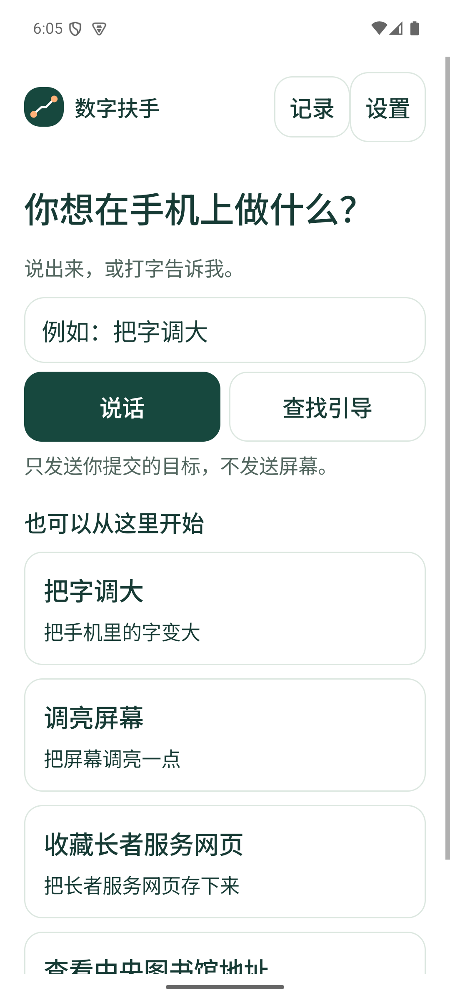

# 数字扶手｜HKU4SDG

**你自己动手，我们陪你走下一步。**

数字扶手是一款面向手机操作求助场景的原生 Android 应用。用户先说出或输入目标，也可以选择任务快捷入口，确认后进入真实系统设置或第三方应用；数字扶手圈出当前一步，提供可折叠文字和可选语音，用户亲手点击、拖动，最后确认结果。

用户只安装一个 `guide` APK。仓库中的 `demo-target` 是团队内部测试夹具，不是用户产品的安装前置条件。

> 0.1.3 修正当前火山 TTS 响应兼容问题，增加 AI／语音演示启动与真实调用检查，明确 AI 和本机匹配的来源。接入方式、比赛要求及验证边界见[AI 与三语语音](docs/ai-voice-demo-2026-10-17.md)。

> 0.1.2 新增浮窗预览避让、直接重播、明确结束回执、亮度目标选择及本机服务诊断。证据和仍未证实的问题见[引导优化记录](docs/guide-reliability-2026-10-09.md)。

> 四项演示基线见 [PR #6](https://github.com/randyxian08/HKU4SDG/pull/6)。0.1.1 新增字体与亮度的手机实验引导；安装方法、中文页面截图和适用边界见[手机测试指南](docs/phone-testing.md)。

## 当前可以做什么

四项任务的已审核演示设备是 **Android 15 / API 35、英文系统、`sdk_gphone64_arm64` 模拟器**。0.1.1 另允许 **Android 8–16 / API 26–36、中文或英文系统**尝试字体、亮度两项引导，首页标作“可试”。手机路径只在唯一识别到当前控件时圈画，无法核对时保留文字退路；这不代表已经逐机验收。Chrome、Maps 仍须符合原演示设备及完整应用版本。

| 任务 | 用户亲手操作 | 应用检测的结果 |
|---|---|---|
| 把字调大 | 在真实系统设置打开 `Display size and text`，拖动 `Font size` | 系统 `font_scale` 增加，再询问是否适合阅读 |
| 调亮屏幕 | 先选择手动或随环境自动；手动路径进入真实设置并拖动滑块 | 手动值增加后等待确认；自动开关分支已实现，但当前模拟器无此控件，仅有合成测试 |
| 收藏长者服务网页 | 在 Chrome **124.0.6367.219** 的指定 GovHK 页面操作书签 | 检测 `Edit bookmark`，等待用户确认；已有书签也可核验 |
| 查图书馆地址 | 在 Google Maps **11.129.0103** 展开香港中央图书馆地点卡 | 指定地址行出现，等待用户确认看到了地址 |

地图任务只查看指定地点的地址，不提供路线导航。所有任务都由用户操作；未知页面撤圈，AI 不替用户点击、输入或提交。

### 已实现的体验

- **三项独立语言设置**：输入、界面文字／AI 提示、语音播报分别选择普通话、粤语和英语。
- **三档帮助**：完整指引、轻提示、自己先试试；按需请求当前一步提示。
- **需求优先的首页**：先说话或输入一句需求，再确认匹配的任务；四个任务保留作快捷入口。不支持的需求会明确说明。
- **浮窗**：默认一句当前提示加“听一次／更多”；收起后直接提供“再听／文字／更多”。同一步滚动时复用窗口，同时避开操作控件与字体预览；滑动方向有箭头。“更多”提供暂停、换位置、静音、语言和结束，结束前可以取消。必要的安全提示与结果确认不能隐藏。
- **首次引导**：依次选择简体／繁体／英语、应用内字号、输入与播报语言，再解释权限及练习圈画；可稍后设置权限。简繁字形不改变所选语言。
- **首次设置与中断恢复**：保留任务和帮助选择，暂停／继续沿用同一次尝试，恢复时重新识别页面。增加受限制设置的人工帮助及应用信息入口；设置中分别展示权限、连接与任务状态，并可主动复制本机诊断。
- **结果确认与记录**：字体和手动亮度可直接选择继续调整；确认或退出后显示明确回执，可返回应用或留在当前页面。本机最多保留 20 次可删除记录，区分确认与未确认结束。
- **受约束 AI 与语音**：Debug 模拟器可经本机代理使用方舟意图识别、火山 ASR 与 TTS。模型只选择四项已审核任务、澄清或拒绝，密钥留在宿主机。代理不可用时保留本地匹配、设备播报或文字／任务卡退路。

## 实际界面

以下为 2026-10-09 模拟器实际运行的中文首页、0.1.2 字体预览避让与结束回执。

<p>
  
  
  
</p>

本次首页、首次设置、浮窗与完成判断的验证见[PR #11 整合记录](docs/ui-integration-2026-10-09.md)。先前 Chrome／Maps 的证据见[浮窗走查](docs/overlay-usability.md)和[界面与端到端验收](docs/uiux-validation.md)。

## 快速运行

需要 JDK 17、Android SDK Platform 35、Build Tools 35、Platform Tools，以及上述演示模拟器。`scripts/dev-env.sh` 默认使用 macOS SDK 路径；其他环境须先设置自己的 `ANDROID_HOME` 与 `JAVA_HOME`。

在仓库根目录执行：

```bash
git switch main
git pull --ff-only origin main
source scripts/dev-env.sh
adb devices
./gradlew :guide:assembleDebug :guide:testDebugUnitTest :guide:lintDebug
./scripts/install-app.sh
adb shell am start -n org.hku4sdg.handrail/.MainActivity
```

先完成首次语言与字号设置，再输入需求或选择任务和帮助方式。跨应用引导首次使用须在系统无障碍设置中亲手开启“数字扶手 · 手机引导”，返回应用后再确认开始。字体任务起始字号须未达到上限；手动调亮须留出调高空间。若自动亮度已开启，应用先引导用户关闭，再调滑块；无法识别则撤圈并允许返回。自动调节只在设备具备该功能且开关唯一可识别时引导。语音拒绝或不可用时，仍可使用文字与任务卡。

不配置云端密钥也可演示任务卡与跨应用引导。云端语音／AI 的本机设置、构建产物、回归命令及排查方式见[开发接手指南](docs/development.md)。

## 验证状态与适用边界

0.1.3 的真实云端调用、Android 模型／播放检查及代理停止退路见[AI／语音验收](docs/validation/ai-voice-2026-10-17.md)。云端能力仍仅连接 Debug 模拟器的本机代理；合成音频回归不代表真人语音验收。

0.1.2 的最新构建、运行检查、版本标识及限制见[验证摘要](docs/validation/reliability-2026-10-09.md)。自动亮度在本次模拟器不具备，自动开关分支不能算设备验收；手机服务自行关闭的根因仍待诊断，不能宣称已经彻底修复。

此前 2026-10-09 整合版通过 Debug、未签名 Release、开发检查 APK、内部夹具构建、28 项 Kotlin 单元测试、9 项代理测试及 Android lint（无错误，guide 有 6 条警告、内部夹具有 3 条警告）。在 API 35 模拟器检查需求输入、英文首次设置、独立语言、三档提示、浮窗控制、1.0／2.0 字号平台焦点及中文字体／亮度设置。滑块不动等待 13 秒不能确认完成；实际数值增加后再由用户确认。GitHub Actions 因账号账单／额度限制未启动，不能算 CI 通过。证据与条件见[整合记录](docs/ui-integration-2026-10-09.md)。

0.1.1 手机实验版通过 28 项 Kotlin 单元测试、Debug／开发检查 APK 构建和 lint，并在 **API 35 模拟器的真实中文设置页面**完成字体、亮度、浮窗收起／换位／暂停恢复和脱敏适配信息检查。vivo X300s 尚未实测；API 36 准入使用合成设备参数验证。详见[手机测试记录](docs/phone-testing.md)。

2026-10-02 功能提交 `b187343` 已通过 Debug、未签名 Release、开发检查 APK、18 项 Kotlin 单元测试、Android lint 及 [GitHub CI](https://github.com/randyxian08/HKU4SDG/actions/runs/36987251577)。1.0 字号字体任务与 2.0 字号亮度任务各完成 20 次原生浮窗操作检查；CI 不包含模拟器检查。

[51 条合成三语开发样本](docs/intent-evaluation.md)中，方舟模型为 51/51，本地规则为 37/51，范围外误匹配均为 0；三语合成音频已通过 TTS→ASR 接口回归。这些不代表真人准确率、粤语音质或学习效果。

尚未验收完整 TalkBack 手势／朗读顺序、真人三语审听、非团队成员试用、稍后独立重做、任意 App 或其他设备。第三方页面加载初期的未识别反馈仍需优化。仓库里标作规划的功能不应当作已交付能力。

## 文档与协作

从[文档导航](docs/README.md)选择产品、开发、演示或验证入口：

- [产品体验方案](docs/product-experience.md)：单 App 的用户路径和功能优先级。
- [开发接手指南](docs/development.md)：环境、模块、云端代理、测试和故障排查。
- [手机测试指南](docs/phone-testing.md)：0.1.1 安装、字体／亮度实验引导及 vivo 测试注意点。
- [可演示案例](docs/demo-cases.md)：四项场景、失败退路和演示口径。
- [0.1.2 浮窗与引导优化](docs/guide-reliability-2026-10-09.md)：预览避让、稳定窗口、亮度分支、权限帮助与诊断。
- [首页与浮窗整合记录](docs/ui-integration-2026-10-09.md)：当前 UI、首次设置、完成条件及真实截图。
- [先前浮窗与第三方案例](docs/overlay-usability.md)：Chrome／Maps 操作和历史验证。
- [MVP 开发计划](docs/mvp-plan.md)：当前交付范围与可观察验收。

认领工作、提交 PR 和合并要求见 [CONTRIBUTING.md](CONTRIBUTING.md)。PR 需说明实际验证和未验证部分；合并前由至少一位同伴审阅。不要提交密钥、`.env`、真实用户录音、身份资料或敏感截图。

[飞书产品定义](https://my.feishu.cn/wiki/FTF5wKcn0iNra6kG2WpcfiZ2nCg) · [飞书进度与案例](https://my.feishu.cn/wiki/NIqHwHf98iIjqektf8KcHtdanZg)
