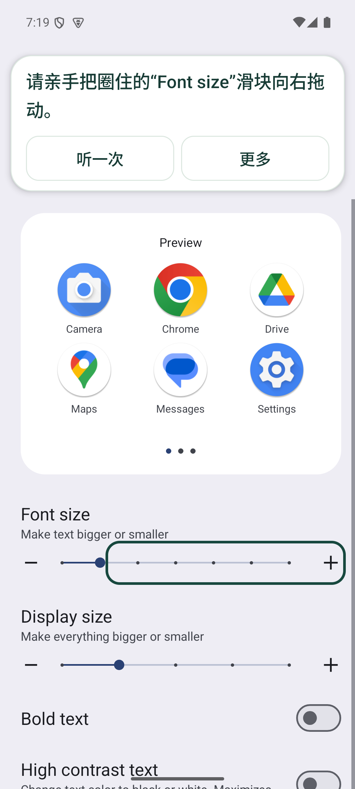
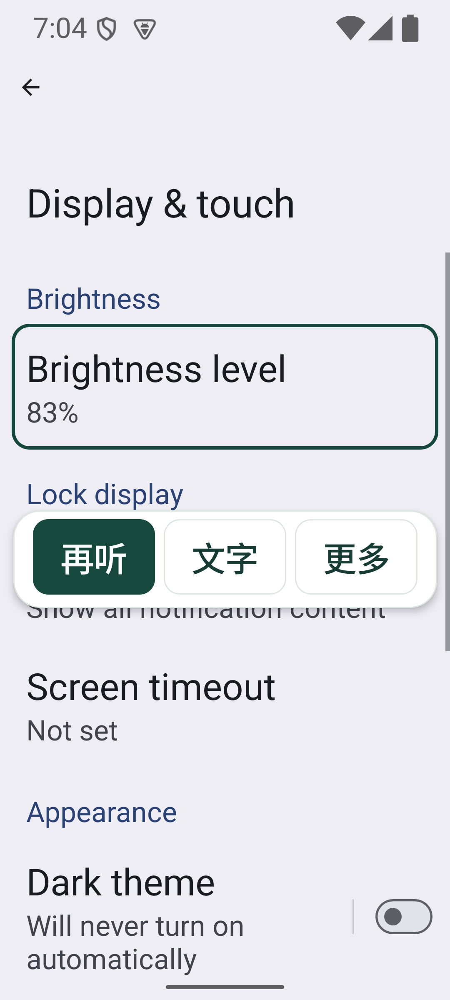
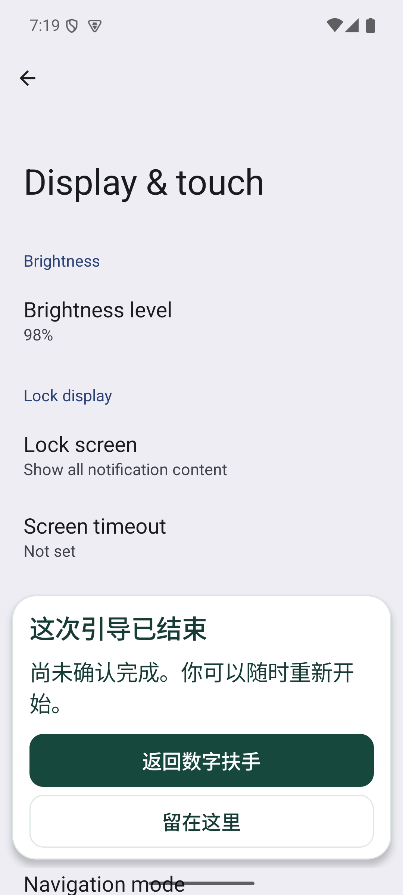

# 数字扶手 0.1.2｜浮窗与引导流程优化

更新于 2026-10-09。本轮处理录屏反馈中的浮窗遮挡、滚动跳动、结束无反馈、权限开启困难及亮度流程中断。应用仍由用户亲手操作，未知页面撤圈，结果须由用户确认。手机无障碍开关自行关闭的根因仍未证实。

## 本轮改变了什么

| 用户遇到的问题 | 0.1.2 的处理 | 如何检查 |
|---|---|---|
| 焦点或播报被系统打断后，任务也被暂停 | `onInterrupt` 停止声音，保留任务；解绑、进程重启与用户暂停分别处理 | 调用真实平台反馈中断，核对同一次任务仍进行、权限仍开启 |
| 页面滚动时提示卡和圈画反复跳动 | 同一步只更新控件几何位置，复用卡片窗口；目标仍变化时重新核对 | 实际滑动设置页面，检查卡片窗口 ID 保持不变 |
| 文字卡挡住字体预览 | 同时保护操作控件和预览区域；空间不足时暂停并说明 | 实际设置页核对预览与卡片边界不相交 |
| 收起后找不到重播入口 | 收起栏直接显示“再听／文字／更多” | 原生操作检查文字恢复、按钮角色及至少 48dp 触控区域 |
| 要滑动时只有文字，方向不明确 | 显示手指滑动方向箭头；圈画无填充、无编号 | 实际页面截图及滚动检查 |
| 退出或完成后不知道下一步 | 持续显示明确回执，提供“返回数字扶手／留在这里”；未确认退出保留独立记录 | 实际字体、手动亮度的数值改变和确认；另检查未确认退出 |
| 自动亮度开启时只提示自行关闭 | 准备页先选手动或随环境自动；手动路径先引导关闭自动开关，再重新记录基线并调滑块 | 分支逻辑及控件歧义单元测试；当前模拟器只具备手动亮度 |
| 首次无障碍开关被限制 | 增加应用信息入口、受限制设置说明及返回开启步骤 | 应用内帮助入口检查；厂商具体菜单仍需实际核对 |
| 反馈无法区分权限、连接和任务状态 | 设置中新增本机诊断，分别显示三项状态，并标记版本和构建时间 | 检查状态及主动复制内容的字段范围 |

补充：窗口系统拒绝渲染时记录异常类别，并撤掉反馈、保留可恢复任务。普通崩溃仍由 Android 正常终止和报告，不做静默重试或自动重新授权。

## 亮度如何选择

**手动调亮**：用户选择“现在自己调亮一点”。如果自动亮度已开启，先唯一识别真实自动亮度开关，用户自行关闭；应用重新记录手动亮度基线，再引导到滑块。手动值增加后，询问是否舒服，等待确认。

**随环境自动调节**：用户选择“随环境自动调节”。引导用户开启真实自动亮度开关；当前系统模式确实为自动且页面控件可核对时，再询问是否符合需要，不要求额外拖手动滑块。

本次 `HKU4SDG_API35` 模拟器的 `android:bool/config_automatic_brightness_available` 为 `false`，真实设置页也没有自动亮度开关。因此自动选项禁用并说明原因，手动路径已在真实设置页验证。自动开／关分支目前只有合成控件匹配与状态测试，不能称为已经完成设备运行验收。无法识别开关时撤圈、允许返回选择，不改变系统设置。

## 诊断与权限帮助

“设置 → 服务状态与诊断”分别显示系统权限、服务连接和本次任务状态。“复制诊断信息”仅主动复制本机元数据：版本／构建时间、厂商／型号／API、最近最多 40 条服务事件、API 30 起的最近最多 5 条自身进程退出原因。异常只记类别，不记录消息或堆栈；不包含页面文字、目标、账号、截图和录音，不自动上传。

测试工具启动 Instrumentation 会结束旧目标进程，并临时重新绑定数字扶手。诊断中的这类进程退出与重新连接属于测试条件，不能据此认定正常使用崩溃。

首次开启受限与开启后服务关闭是两个问题。权限帮助按 [Android 受限制设置说明](https://support.google.com/android/answer/12623953?hl=zh-Hans)提供人工步骤，不能证明录屏中的自动关闭就是此机制导致。[Android 服务生命周期说明](https://developer.android.com/guide/topics/ui/accessibility/views/service)把反馈中断与解绑分开；本版依此修正。退出原因 API 见 [ActivityManager](https://developer.android.com/reference/android/app/ActivityManager#getHistoricalProcessExitReasons(java.lang.String,int,int))。

## 验证条件与证据

验证设备是 Android 15 / API 35、`sdk_gphone64_arm64`、`ranchu`、1080 × 2400 模拟器，应用内字号 1.15。截图使用模拟器数据，不上传用户原始手机录屏或聊天截图。

本轮完整证据见 [验证摘要](validation/reliability-2026-10-09.md)。检查入口为 [run-device-check.py](../scripts/run-device-check.py)，开发环境和命令见 [开发指南](development.md)。日志的 `PASS` 只覆盖对应检查，不替代真人使用、完整 TalkBack 手势或语音审听。

  
  
  

## 协作接手

需求及验收目标见 [Issue #12](https://github.com/randyxian08/HKU4SDG/issues/12)。本轮版本为 0.1.2 / versionCode 3，构建标识显示源码状态和 UTC 构建时间。用户只安装 `guide` APK；开发检查与内部夹具不随用户安装。

下一步需取得发生关闭时的新版本本机诊断，区分权限关闭、服务解绑、进程退出与任务暂停，再针对证据修复。不要把这些状态笼统写成“掉权限”，也不要自动恢复权限。自动亮度分支需要在真实暴露该开关的系统上验证；Chrome／Maps 仍沿用原设备和完整版本准入，本轮没有宣称扩展任意 App。
