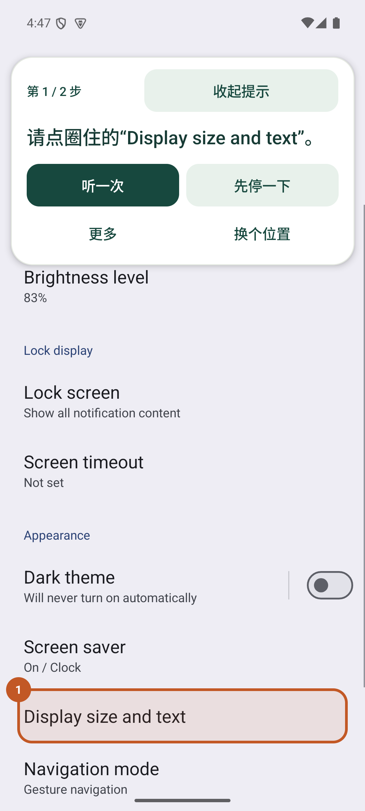
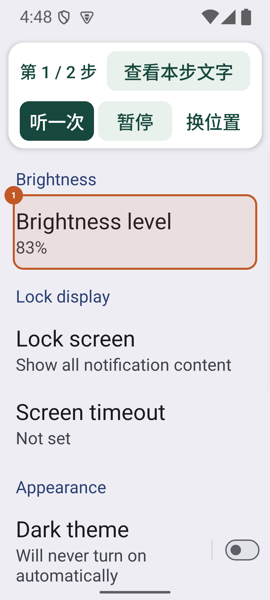
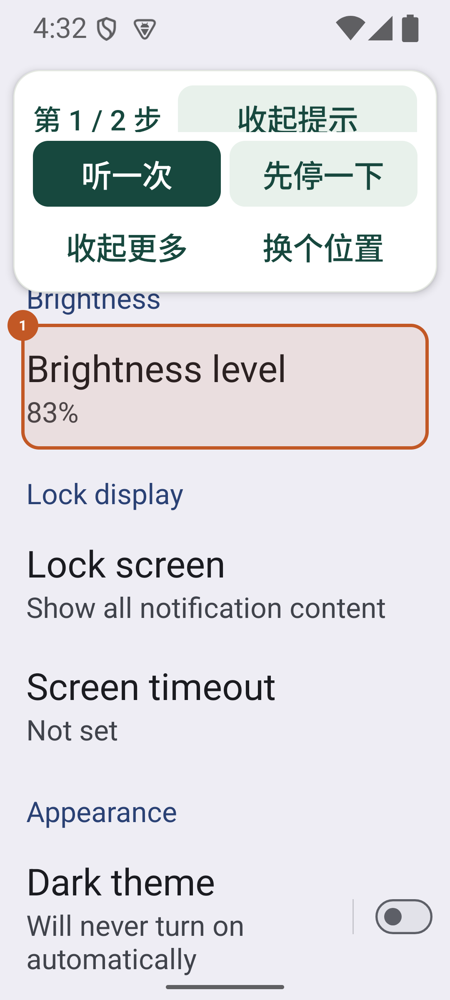
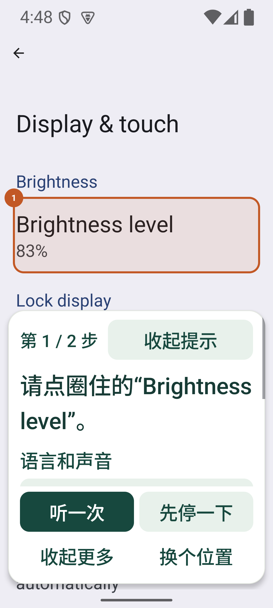
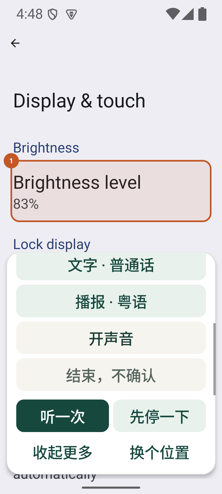
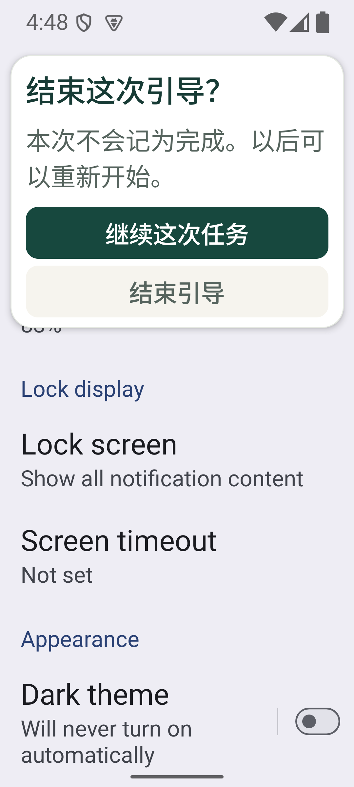
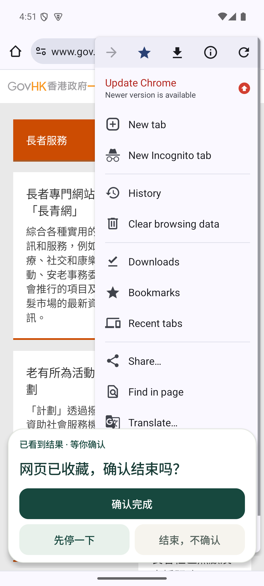
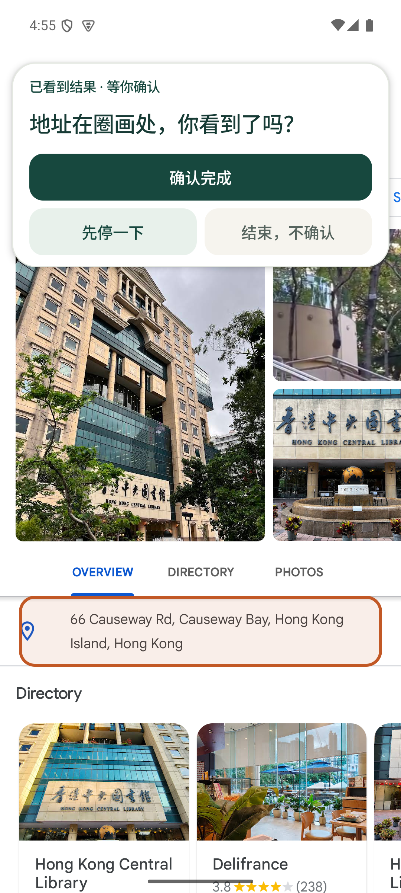

# 数字扶手｜浮窗易用性走查

2026-10-02。本轮检查现有原生 Android 产品，重点是老人进入其他应用后还能否看清、点到、停下和继续。演示设备为 Android 15 / API 35 模拟器，1080×2400，英文系统；用户安装一个 `guide` APK。以下截图来自实际运行，没有用设计稿替代运行证据。

当前结论：浮窗的可操作性有明确改善，但还不能说所有功能都方便，也没有目标用户研究或完整读屏验收支持“顶尖 UIUX”。首页、权限与四项任务的前一轮证据见[界面与端到端验收](uiux-validation.md)，本报告单独记录本轮浮窗变化。

## 五段用户路径与健康度

1. **开始任务：已测路径可用，加载反馈仍需优化。** 首页保留四项任务，详情解释目标和帮助方式，用户确认后进入真实应用。第三方页面加载时尚不能识别，先停止圈画；待已审核页面出现后重新核对。这个安全退路目前仍显得生硬，需要明确区分“正在核对”与“页面不支持”。

2. **看提示并亲手操作：通过当前设置页面。** 一次显示当前一步；文字默认展开，可以收起。圈画不接收触控，用户点击和拖动目标应用的原控件。卡片避开完整目标控件以及状态栏、导航栏；显示空间不足时暂停圈画并说明如何滚动、重新检查。

   

3. **减少遮挡与换位置：通过所测字号。** 收起后只保留步骤、恢复文字入口及听一次／暂停／换位置。1.0 字号下高度由展开的 617px 降至 363px，2.0 字号下由 901px 降至 427px；这是同一版本展开与收起的比较。无需拖拽浮窗；点击换位置会优先选择能显示完整指令的一侧。

   

   走查曾发现：2 倍字体时，完整浮窗强行移到上方只能留下半个文字恢复按钮，虽然主要操作仍在，实际上很难使用。现在另一侧放不下完整提示时保留可读的位置并告知用户；收起后可在空间足够时移过去，重新展开会重新检查空间。

   | 本轮中途发现的问题，已修复 | 最终保留可读位置 |
   |---|---|
   |  |  |

4. **调整语言与声音：通过界面操作，音质不在本轮结论中。** “更多”收纳文字语言、播报语言、声音和结束入口；选项可以滚动，播放与暂停固定。语言直接选择普通话、粤语、English，并提供单选语义；不再靠反复点击猜下一种语言。测试从普通话切到英语、粤语、再回普通话，输入与播报语言保持独立。

   

5. **暂停、退出和确认结果：通过已测状态。** 暂停／继续沿用同一次任务；选择的浮窗侧边在空间允许时保留。点结束先解释“本次不会记为完成”，可以继续原任务。确定结束仅写一条未确认记录。检测到实际结果仍须用户确认；这次手动字体任务的会话 39、45 各写入一条确认记录。

   

## 发现的问题与对应修复

| 问题 | 对使用者的影响 | 本轮处理 |
|---|---|---|
| 收起后仍有多余文字和次级操作 | 占住原应用，收起收益小 | 收成步骤和三个必要操作，保留恢复文字入口 |
| 整张卡片一起滚动 | 滚语言选项后找不到暂停／播放 | 只滚内容，主要操作固定在卡片底部 |
| 位置计算依赖估计边距 | 大字体可能遮住目标或系统栏 | 使用系统边界与目标控件实测范围，无安全位置时暂停 |
| 换位置只检查按钮空间 | 指令被挤掉，测试通过但视觉不可用 | 优先保证完整指令；加入截图走查和指令高度检查 |
| 三列长按钮在 2 倍字体下生硬断行 | “先停一下”等文字分裂 | 收起状态采用短标签，读屏描述保留原动作含义 |
| 语言按钮循环切换 | 用户不知道会换成哪种 | 改为可见的三项直接选择，提供选中语义 |
| 结束立即丢失活动任务 | 容易误退，无法撤销当次操作 | 增加结束确认；取消后继续同一次任务 |
| 未识别页面要求重新开始 | 给用户造成不必要的重来压力 | 明确停止圈画；回到原页面重新核对，也可返回任务 |

改动范围为浮窗与状态连接。没有新增自动代点、自动输入、付款或任意应用操作。

## 验证与可复现证据

本轮 Debug、未签名 Release、开发检查 APK、内部测试夹具构建通过，18 项 Kotlin 单元测试和 Android lint 通过。新增 3 项位置测试覆盖完整目标避让、侧边空间不足以及无法安全放置。CI 的构建不代表已运行模拟器操作检查。

新增的原生浮窗检查使用 `FLAG_DONT_SUPPRESS_ACCESSIBILITY_SERVICES`，让数字扶手服务实际运行。在 1.0 字号字体任务与 2.0 字号亮度任务中，分别执行收起／展开、换位置、滚动更多、直接选三语、取消结束、暂停／继续、最终结束。检查按钮角色、至少 48dp 的可点击边界、卡片不盖完整目标控件、主要操作不随滚动移动、会话不变，以及最终仅写一条未确认记录。逐项日志：[1 倍字号](validation/overlay-1x-2026-10-02.txt)、[2 倍字号](validation/overlay-2x-2026-10-02.txt)。

检查工具曾在卡片窗口重建期间过早取窗口而失败；没有 Android 崩溃日志。补充有界等待后，两组重新运行通过。验收采用最终通过日志与截图；中途失败不计为成功，也没有沿用失败时缓存的旧截图。

当前 APK 另以实际触控复查 Chrome 124 与 Google Maps 11.129：Chrome 页面加载后圈出菜单，打开菜单看到已有书签的 `Edit bookmark` 后等待确认；这是既有书签核验，没有新建书签。Maps 地点卡展开后圈出图书馆地址并等待确认。截图如下，结束后的会话与单条记录见[本轮尝试摘要](validation/overlay-attempts-2026-10-02.json)。页面加载初期曾短暂出现未识别提示，随后回到已审核页面正常引导；这个反馈仍列为待优化问题。

| Chrome 已有书签核验 | Maps 地址展示 |
|---|---|
|  |  |

```bash
source scripts/dev-env.sh
./gradlew :guide:assembleDebug :guide:assembleRelease :guide:assembleDebugAndroidTest :demo-target:assembleDebug :guide:testDebugUnitTest :guide:lintDebug
adb install -r guide/build/outputs/apk/debug/guide-debug.apk
adb install -r guide/build/outputs/apk/androidTest/debug/guide-debug-androidTest.apk
adb shell am instrument -w -e check overlay org.hku4sdg.handrail.test/org.hku4sdg.handrail.AccessibilityCheck
# 2.0 字号亮度任务加上 -e task brightness
```

运行前必须没有活动引导，并自行设好 `font_scale`。启动 Instrumentation 会结束先前目标进程；检查程序等待服务重新绑定，需在启动后重新绑定数字扶手服务。只改数字扶手的服务项，保留已有其他无障碍服务。检查结束会结束测试进程，不是正常使用中的崩溃。开发检查 APK 不属于用户产品。

依据：[Android 无障碍触控目标](https://developer.android.com/guide/topics/ui/accessibility/apps)、[系统窗口边界](https://developer.android.com/reference/android/view/WindowInsets)。采用固定主要操作、随系统字体缩放和安全区域避让，不据此宣称完整无障碍合规。

## 下一步优先级

先改善第三方页面加载／核对／不支持的反馈，再完成读屏焦点、返回手势与朗读顺序的实际走查。随后让不熟悉产品的人用自己的说法开始任务、暂停、继续并稍后独立重做，记录是否理解提示、是否误触和在哪一步求助。语音自然度与粤语措辞也需要实际审听和母语复核。

本轮平台点击、角色和边界检查没有验收完整 TalkBack 手势、朗读顺序、真人语音识别、任意第三方页面、其他设备或真实学习效果。2 倍字体的选项需要滚动，浮窗仍会覆盖部分非目标内容；顶级体验不能由绿色测试或几张截图证明。
