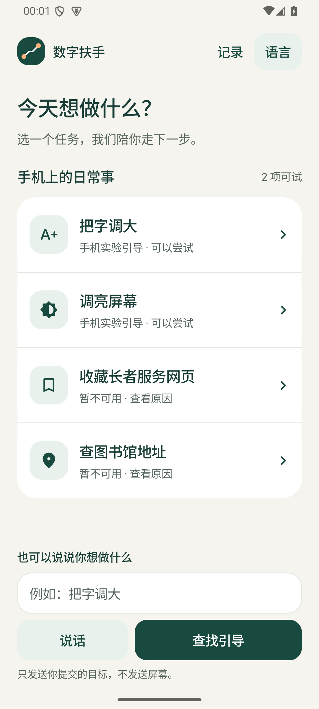
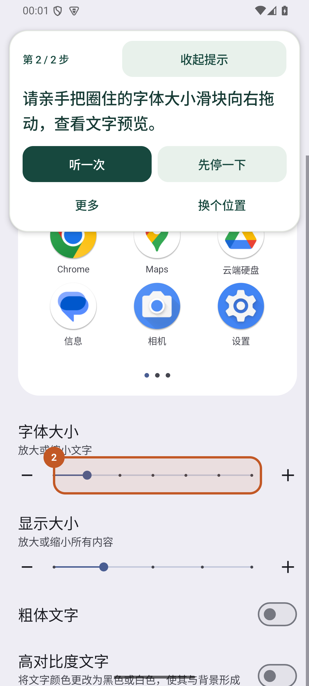
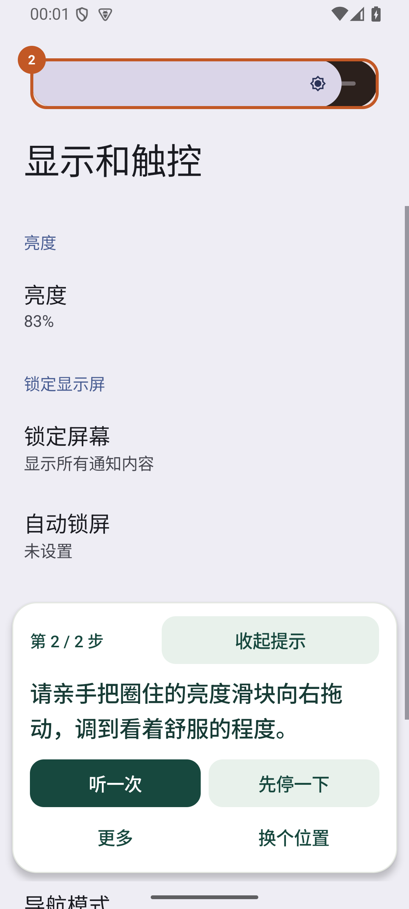
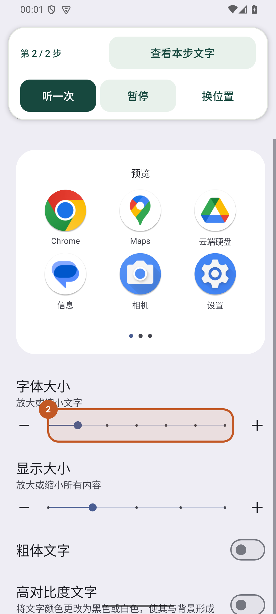

# 数字扶手｜手机实验版安装与测试

当前 0.1.2 增加预览避让、重播、结束回执、亮度目标选择及本机服务诊断，见[最新优化记录](guide-reliability-2026-10-09.md)。下文保留 **2026-10-03 / 0.1.1** 的安装与验收历史，其中“先自行关闭自动亮度”是旧版条件。新版本可在准备页选择手动或自动，实际支持及未验证部分以最新记录为准。

历史记录更新于 2026-10-03，版本 **0.1.1**。源码分支：`codex/phone-settings-trial`，基于 `main` 的 `a6cea11`；合并前需切换到此分支构建手机实验版。本轮移除了字体、亮度任务对模拟器型号的硬性限制，并增加手机设置控件识别。用户只安装一个 `guide` APK；不需要 Android Studio、USB 调试或内部测试应用。

## 安装并开始

1. 把 `HKU4SDG-0.1.1-phone-test.apk` 传到手机，用文件管理器打开。系统要求时，允许该来源安装未知应用，再返回安装页。
2. 打开“数字扶手”，选择“把字调大”或“调亮屏幕”。符合实验准入的手机会显示“2 项可试”和“手机实验引导”。
3. 按应用中的权限说明，亲手开启系统无障碍设置里的“数字扶手 · 手机引导”。返回原任务，点“打开设置，开始”。
4. 点击圈出的设置入口，再亲手拖动字体或亮度滑块。文字提示可以收起、恢复、换位置，任务可以暂停、继续。
5. 系统值增加后，应用询问效果是否合适；只有用户确认才保存为完成。字体从未达到最大档开始，亮度先关闭自动调节并留出调高空间。

安装来源授权见 [Android 官方说明](https://developer.android.com/distribute/marketing-tools/alternative-distribution)。Android 13 及以上如果阻止开启无障碍并显示“受限制的设置”，可按 [Android 官方说明](https://support.google.com/android/answer/12623953?hl=zh-Hans)进入“设置 → 应用 → 数字扶手 → 更多 → 允许受限制的设置”。手机菜单可能不同，只在系统实际出现该提示时处理。

同一开发证书签名的 0.1.0 可覆盖安装升级。签名不同导致拒绝覆盖时，先保留需要的记录，再决定是否卸载；不要直接清除数据。

## 本版范围

| 项目 | 0.1.1 行为 |
|---|---|
| 可安装 | Android 8.0 / API 26 起；Debug 测试包，已签名，未设置 `testOnly` |
| 字体与亮度实验准入 | Android 8–16 / API 26–36、中文或英文系统、系统设置应用已安装并启用 |
| 圈画 | 只接受唯一匹配、可见且可用的真实滑块或可点击入口；字体与粗细／显示大小、普通亮度与 HDR／自动亮度分开识别 |
| 页面不匹配 | 撤圈、给出文字退路，可以自行调整、返回任务或结束 |
| 结果 | 检测实际系统字号／手动亮度值增加，再等待用户确认；滑块上限按当前控件范围判断 |
| 输入、文字、播报 | 三项语言选择保持独立。手机语音输入／播报使用设备服务，语言可用性取决于已安装服务；文字和任务卡始终保留 |
| 云端 AI／语音 | 火山、方舟的本机开发代理仍仅用于 Debug 模拟器；手机没有云端直连，本包不含 API Key |
| Chrome、Maps | 沿用原 API 35 英文模拟器及完整版本要求，尚未开放手机适配 |

以上是允许尝试的条件，不是对所有手机的兼容性认证。厂商页面、无障碍控件和语音服务仍可能不同。应用不会替用户点击、输入或提交。

## vivo X300s / OriginOS 6

用户提供的“关于手机”截图显示 vivo X300s、OriginOS 6 和中文界面。[vivo 官方规格页](https://www.vivo.com.cn/vivo/param/x300s)列出 OriginOS 6 基于 Android 16；这不能代替读取用户手机当前 API 版本或实际设置页面。

本版不再因 vivo 型号拒绝字体、亮度任务。若系统直达入口落在不同页面，按文字提示寻找“字体大小／字体大小与粗细”或“显示、亮度与护眼”中的亮度。识别到唯一实际控件后才会出现圈画；尚未在这台 vivo 上证明该行为。

在未识别的设置页面，浮窗提供“复制适配信息”。点击后把内容粘贴到反馈中即可，无须先接 USB：

- 包含设备厂商、型号、Android API、系统语言，以及当前设置页的控件 ID、父子关系、边界与控件状态。
- 页面文字只保留已知的字体／亮度／显示标签，其余文字置空；不包含账号文字、序列号、IMEI、截图或录音。
- 信息只在主动点击时写入剪贴板，不会自动上传；最多导出 160 个节点，超出时注明截断。

## 实际验证证据

**2026-10-02 至 10-03，Android 15 / API 35、`sdk_gphone64_arm64` 模拟器、真实中文系统设置页面**：字体和亮度均完成入口识别、滑块圈画、实际值增加及用户确认；浮窗收起、换位、暂停／恢复沿用同一次尝试；未知设置页面未圈画，并通过适配信息白名单检查。运行日志见[原生回归记录](validation/phone-settings-zh-2026-10-03.txt)。

<p>
  
  
  
  
</p>

构建、28 项 Kotlin 单元测试和 lint 通过。合成设备参数验证 API 36、中文、非模拟器型号能开始两项设置任务，Chrome／Maps 仍被限制；歧义、隐藏／停用控件、HDR／自动亮度控件及适配信息脱敏有独立单元测试。

这些截图来自模拟器，不是 vivo；API 36 合成测试不是 Android 16 运行验收。未验证 vivo 的实际设置树、权限菜单、后台保活、设备语音、完整 TalkBack 或真人试用。该测试包没有上架应用商店。

## 开发回归入口

按[开发指南](development.md)准备环境并构建 `:guide:assembleDebugAndroidTest`。`PhoneSettingsCheck` 使用真实中文系统页，保存并恢复应用偏好和记录；要求开始前没有正在进行的任务，并且无障碍服务已启用。它会改变系统字号和亮度，结束后须恢复原值与系统语言。

```bash
source scripts/dev-env.sh
adb -e install -r guide/build/outputs/apk/debug/guide-debug.apk
adb -e install -r guide/build/outputs/apk/androidTest/debug/guide-debug-androidTest.apk
adb -e shell am instrument -w -e check phone org.hku4sdg.handrail.test/org.hku4sdg.handrail.AccessibilityCheck
```

测试前在模拟器系统设置里将中文设为首选语言，字号设置为 1.0、手动亮度设置为 102。Instrumentation 会结束旧应用进程；收到 `Waiting up to 10 seconds` 后，立即按[开发指南的服务重绑步骤](development.md#6-运行哪些检查)仅重新绑定数字扶手，保留其他已启用服务。结果须出现 `PASS`，不能只看 `adb` 退出码。测试截图保存在应用缓存目录 `phone-*.png`，供开发者提取核对。
