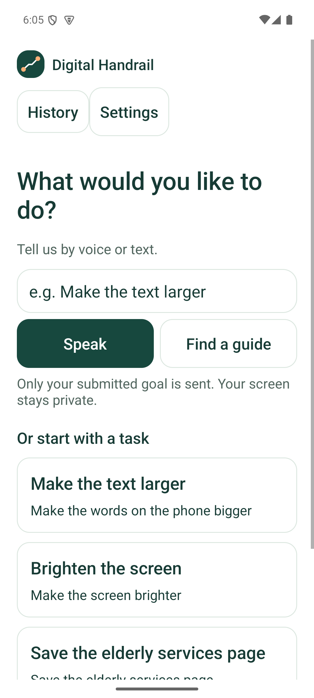
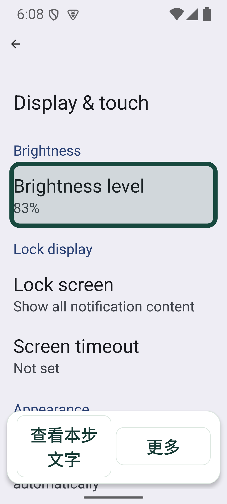
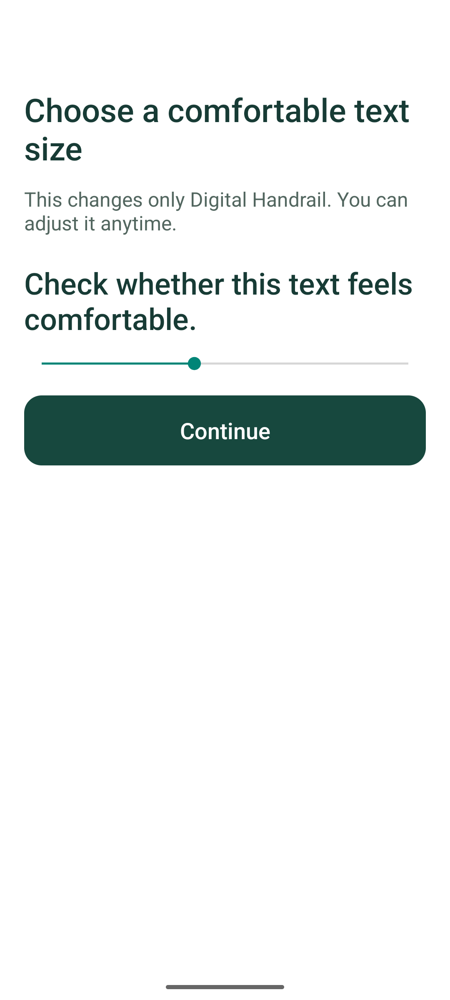
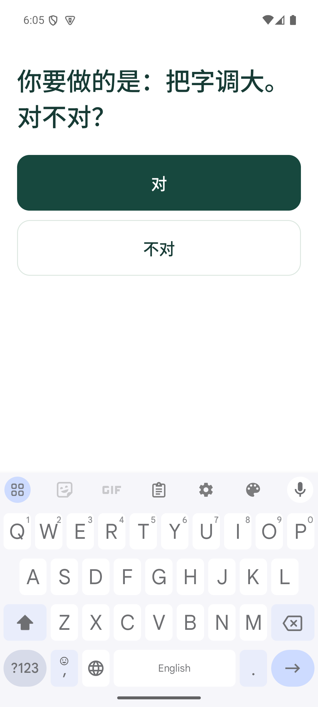
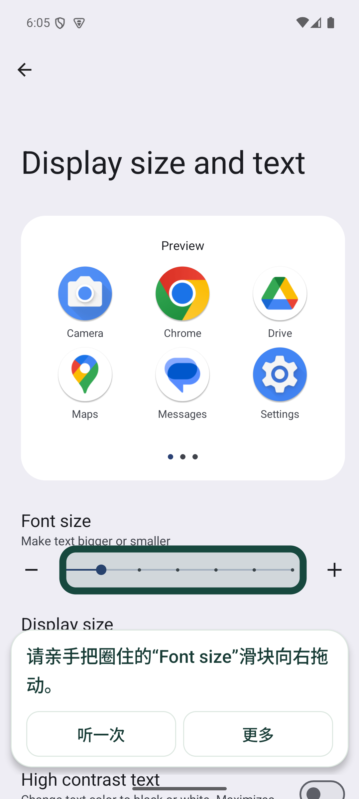
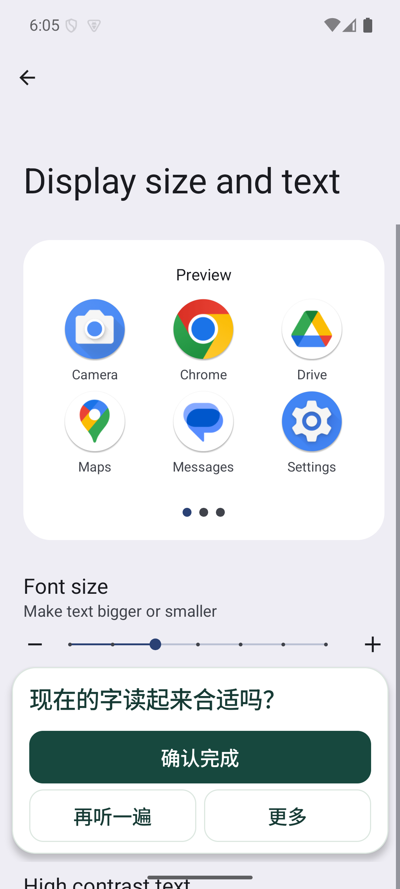

# 数字扶手｜需求优先的首页与 PR #11 整合

2026-10-09。延续 [PR #11](https://github.com/randyxian08/HKU4SDG/pull/11) 的白底、深绿、大字、短句提示及首次引导，保留同伴原提交，再补齐操作和状态检查。关联现有 [三语能力 #2](https://github.com/randyxian08/HKU4SDG/issues/2) 与 [完成确认 #7](https://github.com/randyxian08/HKU4SDG/issues/7)。

## 用户现在怎么用

1. 首次打开选择简体／繁体／英语、应用内字号、输入语言和播报语言。权限页说明无障碍服务的用途；可以先探索，再在开始真实引导时开通。麦克风只在主动说话时申请。
2. 首页先问“你想在手机上做什么？”，直接说话或打字。意图匹配后先确认目标，再展示任务详情；下方四个任务是快捷入口。
3. 进入原应用，由用户亲手点圈住的位置。默认浮窗只有一句当前提示和“听一次／更多”；提示可以收起，收起后保留“查看本步文字”。更多操作包括暂停、换位置、静音、文字／播报语言及结束。
4. 完整指引、轻提示、自己先试试三档继续可用。轻提示默认收起；按需模式不提前圈目标，主动请求提示后才显示。滚动、安全说明与结果确认不能隐藏。
5. 检测实际结果后再请用户确认。字体／亮度可以继续调整；取消结束会回到同一次尝试，结束但未确认会记为未确认结果。

| 中文首页 | 英文首页 | 2 倍系统字号收起浮窗 |
|---|---|---|
|  |  |  |

## 整合时修复的问题

| 原改动中的问题 | 整合后的行为 |
|---|---|
| 首页还是先列任务，输入放在下方 | 需求输入与说话优先，任务保留作快捷入口 |
| 英语首次设置仍出现固定中文步骤 | 首次设置与调整页跟随文字语言，语言名称便于识别 |
| 输入语言看似多选，识别器实际只选一个 | 明确单选，输入、文字、播报分别保存；简繁字形不重置文字语言 |
| 简化浮窗时移除了暂停、重听、收起等操作 | 默认短提示，次级操作渐进展开；收起时也关闭“更多”，确实减少遮挡 |
| 滑块不变也能在 12 秒后或普通点击后显示完成 | 移除计时／任意点击完成条件，读取实际系统值或登记页面结果，再等待用户确认 |
| 澄清和不支持给相同追问，容易反复询问 | 区分需要补充、不支持、服务不可用，保留任务卡退路 |
| 按住说话与既有录音／权限状态不一致 | 保留明确的点击开始／结束录音与转写预览，进入设置先停止收音 |

采用较细边框、明确主按钮及至少 48dp 的可点击区域；应用内字号默认 1.15 倍、可调 0.9–1.5 倍，同时响应系统字号。2 倍系统字号下需要滚动，不能保证所有入口同时出现在首屏。简繁转换是应用内轻量字符映射，不等于完整母语校对。

## 实际验证

设备为 `HKU4SDG_API35`、Android 15 / API 35、`sdk_gphone64_arm64` 模拟器，1080×2400。使用真实系统设置和数字扶手无障碍服务；开发检查 APK 是测试工具，不是第二个用户产品。

- **构建与静态检查**：Debug、未签名 Release、开发检查 APK、内部夹具构建通过；28 项 Kotlin 单元测试、9 项代理单元测试通过。Android lint 无错误，guide 6 条警告、内部夹具 3 条警告。
- **首页与首次设置**：英语步骤走通，输入／文字／播报独立；更改简繁字形不重置粤语文字。输入在任务前面，输入“把字调大”进入目标确认；云代理未运行时本地匹配仍可用。本轮没有重新评测真实模型。
- **完成条件**：按需请求提示后，滑块不动等待 13 秒，不出现确认完成按钮，也没有确认记录；实际增大字号后出现舒适度询问，用户确认后写入记录。
- **帮助与浮窗**：轻提示起始收起，按需提示每步主动请求；1.0 字号字体任务、2.0 字号亮度任务检查展开／收起、换位、暂停／继续、取消结束及最终结束。收起卡片比展开小，所查卡片不盖目标控件，主要按钮有角色与至少 48dp 边界。
- **平台焦点**：启用 TalkBack 15.0 后，1.0／2.0 字号各检查九次焦点、角色、边界及平台点击；检查标题、详情展开和三语刷新。检查工具先滚动完整显示按钮，避免把被固定页脚截住的可见部分当成整个触控区域。
- **中文系统**：真实中文设置的字体行、滑块、亮度、实际数值增加和用户确认通过；未知设置页停止圈画，用户主动导出的适配信息仅含允许标签。截图：[字体行](screenshots/android15-oct9-font-row-zh.png)、[字体滑块](screenshots/android15-oct9-font-slider-zh.png)、[亮度滑块](screenshots/android15-oct9-brightness-slider-zh.png)。

原始记录：[主路径](validation/ui-integration-2026-10-09.txt)、[1 倍浮窗](validation/ui-overlay-1x-2026-10-09.txt)、[2 倍浮窗](validation/ui-overlay-2x-2026-10-09.txt)、[1 倍焦点](validation/ui-a11y-1x-2026-10-09.txt)、[2 倍焦点](validation/ui-a11y-2x-2026-10-09.txt)、[中文设置](validation/ui-phone-zh-2026-10-09.txt)、[本地构建摘要](validation/ui-build-2026-10-09.txt)。

| 英文首次字号设置 | 输入后的目标确认 | 未动滑块等待 13 秒 | 实际改变后确认 |
|---|---|---|---|
|  |  |  |  |

## 复现与边界

构建命令和服务重新绑定示例见[开发指南](development.md)。安装产品 Debug APK 及开发检查 APK 后，在对应系统语言与字号运行：

```bash
adb shell am instrument -w -e check integration org.hku4sdg.handrail.test/org.hku4sdg.handrail.AccessibilityCheck
adb shell am instrument -w -e check overlay org.hku4sdg.handrail.test/org.hku4sdg.handrail.AccessibilityCheck
adb shell am instrument -w -e check overlay -e task brightness org.hku4sdg.handrail.test/org.hku4sdg.handrail.AccessibilityCheck
adb shell am instrument -w org.hku4sdg.handrail.test/org.hku4sdg.handrail.AccessibilityCheck
adb shell am instrument -w -e check phone org.hku4sdg.handrail.test/org.hku4sdg.handrail.AccessibilityCheck
```

运行前没有活动引导。启动测试后须在另一终端重新绑定数字扶手，保留其他已启用服务。integration 使用英文系统、起始系统字号 1.0；phone 使用真正的中文系统、起始字号 1.0 与未达上限的手动亮度。焦点检查先启用 TalkBack。测试恢复原应用偏好及练习记录，改变系统值的检查会恢复起始数值；测试结束会结束目标进程，需要重新绑定服务。

GitHub Actions 初次运行因账户账单／额度限制未启动：[运行记录](https://github.com/randyxian08/HKU4SDG/actions/runs/37911119692)。这是基础设施阻塞，不是远端构建通过；本轮证据来自本地完整检查及模拟器运行。

本轮保留四项登记任务和设备／语言／应用版本准入，没有开放任意第三方 App。Chrome、Maps 的先前操作证据见[原走查](overlay-usability.md)，本轮未重做它们的业务流程。尚未验收完整 TalkBack 手势／朗读顺序、真人三语录音与音质、长者试用或学习效果。
