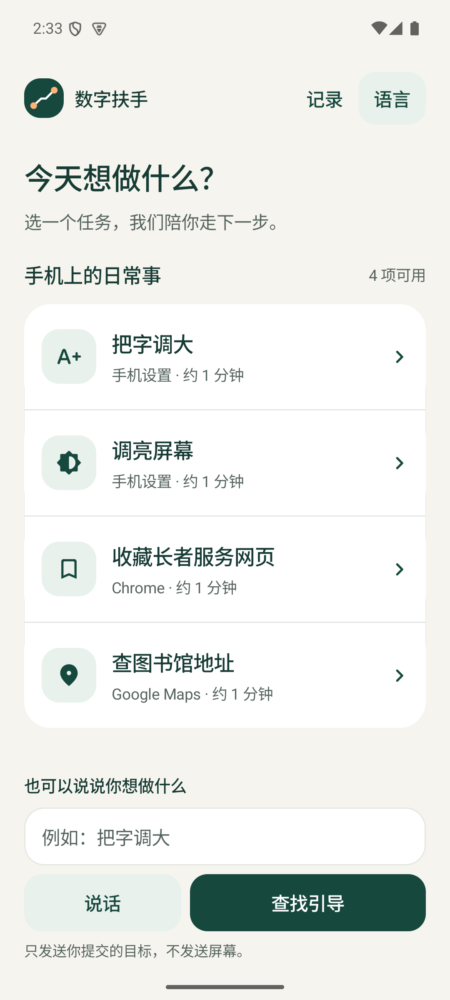
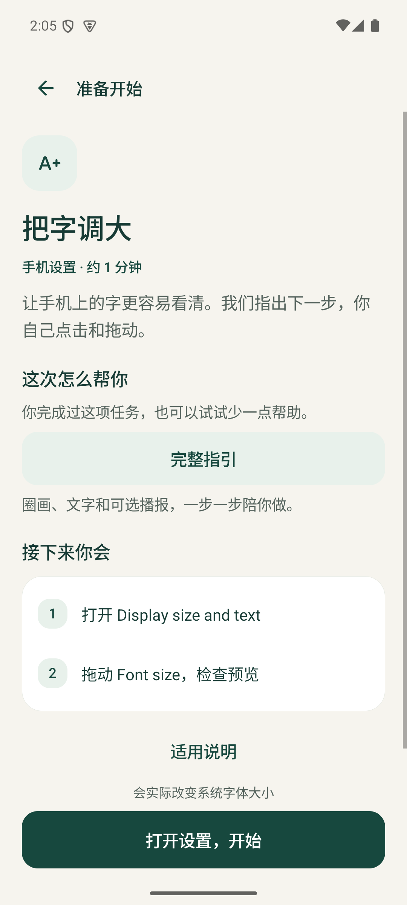
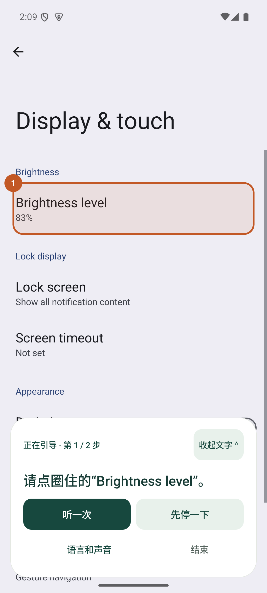
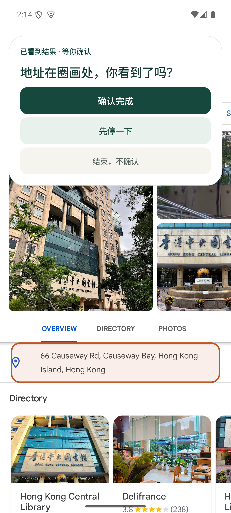
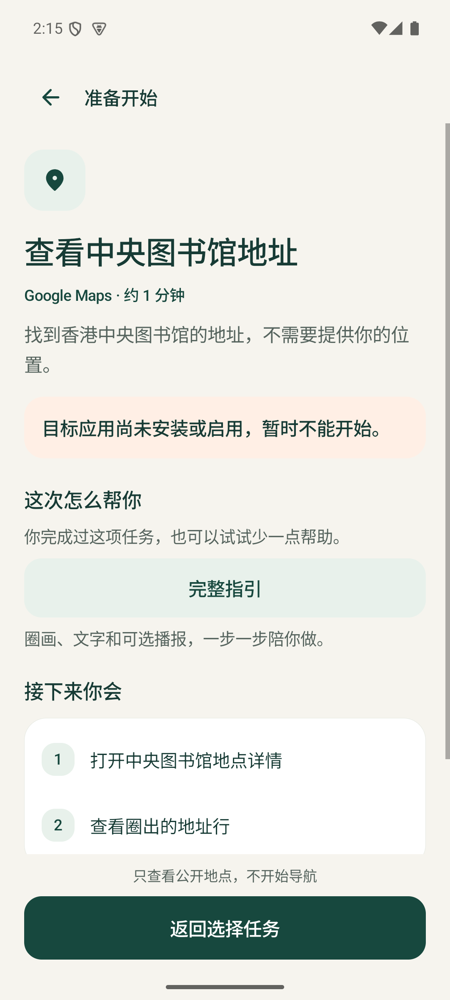
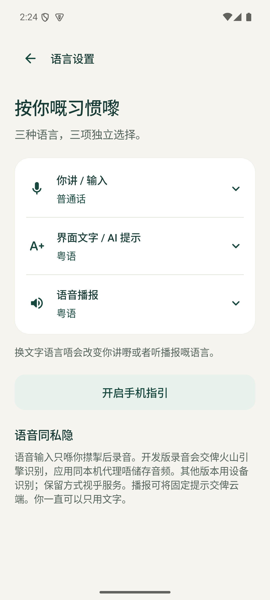
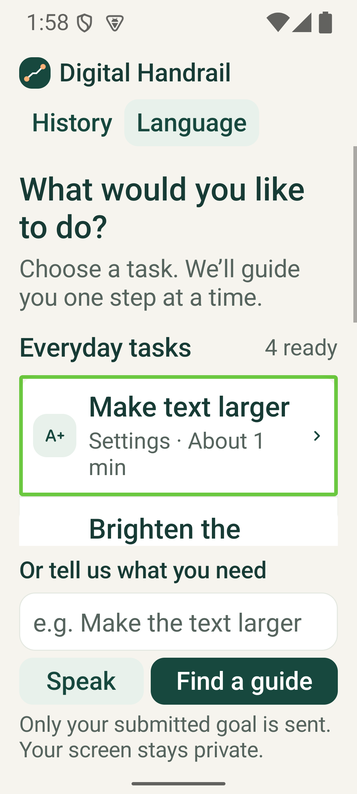

# 数字扶手｜界面与端到端验收

2026-10-02。本轮为原生 Android 界面改版与运行回归；演示设备就是当前 Android 15 / API 35 的 Pixel 7 模拟器。报告使用本轮实际截图，不把设计稿或历史截图当作当前运行证据。用户仍只安装 `guide` 一个产品 APK。

## 用户路径走查

1. **选择目标：通过。** 首页把四项日常任务放在同一白色列表中，用短标题、所属应用和预计时间帮助选择。输入区保留独立“说话”“查找引导”按钮。大字号时任务区可滚动，页头和提交区保留。

   

2. **确认任务与帮助：通过。** 先说明本次目标，再给出完整指引、轻提示、自己先试试三档选择及步骤概览。适用说明可展开；返回和开始入口固定在屏幕边缘。大字号测试发现正文滚动会把返回按钮带走，已修复并重测。

   

3. **跨应用亲手操作：通过当前范围。** 本步文字、重听、暂停优先显示；语言与声音设置进入次级入口。文字可收起，浮层按目标位置移到另一侧。静音只关闭自动播报，主动点“听一次”仍可播放；当前页无法识别时撤圈。

   

4. **核对结果：通过。** 字体 `font_scale` 实际由 1.0 变为 1.3，亮度值由 102 经手动调整变为 178。检测到变化后等待用户确认，仍可继续调整。Chrome 本轮核验已有 GovHK 书签的 `Edit bookmark`，没有把既有书签核验说成新建书签。Maps 指定地点详情的地址行出现后圈画并等待确认。首次四项回归的会话 25、27、28、30 各写入一条确认记录；录像重做的字体会话 31 也只写入一条。误入其他地点的尝试记为未确认结束。

   

5. **出错与返回：通过已测路径。** 停用 Maps 后首页仅 3 项可用，任务显示原因并阻止开始；重新启用后恢复 4 项。进入未登记地图地点时，原圈画消失。麦克风拒绝和静音录音都提供文字／任务卡退路。录音中进入任务页后，晚到回调没有把界面带回首页或改写当前任务。

   

字体任务实录（8.24 秒，静音）：首页→任务→真实设置两步→字号变化→等待确认。录像保存在飞书[进度与案例](https://my.feishu.cn/wiki/NIqHwHf98iIjqektf8KcHtdanZg)的本轮章节；其余任务有独立截图与确认记录。

## 无障碍与三语

首页、任务、语言、记录、首次设置、恢复页以及浮层控件都跟随所选文字语言。输入、文字、播报三项设置独立；系统和第三方 App 的原有英文按钮名保持原样。



TalkBack 15.0 已启用时，原生 Android 无障碍接口分别在 1.0 和 2.0 字号运行同一组 8 次操作：焦点移动、Button 角色、至少 48dp 的控件边界、无障碍点击；同时检查标题语义、详情展开状态，以及英→粤→普通话页面刷新不改变输入和播报语言。两组均通过。测试使用 `FLAG_DONT_SUPPRESS_ACCESSIBILITY_SERVICES`；测试程序是开发工具，不是用户要装的第二个产品。



这组结果只证明所查控件能获得无障碍焦点和执行平台操作，没有验收完整 TalkBack 手势、朗读顺序、音频自然度或目标用户理解程度。2 倍字号需要更多滚动；固定输入区仍占有较大空间，之后应由实际用户走查决定是否改成单独输入页。不能由截图或自动检查宣称完整无障碍合规。

设计参考：[Apple HIG 无障碍](https://developer.apple.com/design/human-interface-guidelines/accessibility)、[Android 无障碍设计](https://developer.android.com/guide/topics/ui/accessibility/apps)、[Android 无障碍测试](https://developer.android.com/guide/topics/ui/accessibility/testing)。本轮采用文字随系统字号缩放、触控目标、文本／语音并存及内容分层。图标来自 [Google Material Icons](https://github.com/google/material-design-icons)，许可证随仓库保存；品牌图形沿用项目现有标志。

## 任务审核目录

[TaskCatalog.kt](../guide/src/main/java/org/hku4sdg/handrail/TaskCatalog.kt)登记任务 ID、审核修订、目标包名、App 完整版本、审核日期、来源、前置条件、结果与证据。当前目录为修订 1：Android 15 / API 35、`sdk_gphone64_arm64`、英文系统页面；Chrome **124.0.6367.219**、Maps **11.129.0103**。系统任务不以 Settings App 版本号代替系统条件。

首页、开始、恢复和服务处理当前页面时都会重新检查；版本改变、App 缺失／停用、系统或系统语言不在范围内时阻止使用。匹配目录后仍须实时核对目标页面和控件。3 项目录单元测试覆盖精确版本变化、缺失应用、系统／语言改变和独立任务可用性；模拟器实测停用／启用 Maps 的变化。没有通过安装其他版本来宣称版本变化实测，也没有完整审核后台或独立同伴批准证据。

## AI、语音与构建

- 真实方舟 Mini 在扩充后的 51 条合成三语回归句上决策与任务 ID 全部一致；本地规则为 37/51，范围外误匹配均为 0。开发集及逐条结果见[意图验收](intent-evaluation.md)，不当作真人准确率。
- 火山 TTS 分别返回普通话、粤语和英语 MP3；对应短句通过流式 ASR 返回“我想把字调大。”“我想放大啲字。”“Make the text bigger.”。这是合成音频接口回归，尚未真人审听或估计识别率。首次代理测试因本轮临时启动脚本缺少 Python 模块搜索路径返回 502；按正常脚本路径启动后 3/3 请求返回 200。没有修改系统网络代理。
- Debug APK、未签名 Release、15 项 Kotlin 单元测试、9 项语音代理测试及 Android lint 通过。本轮原生无障碍检查需在模拟器单独运行，GitHub CI 的普通构建不代表已经执行该设备检查。

复现原生无障碍检查时，先结束活动引导，安装 `guide-debug.apk` 和开发用 `guide-debug-androidTest.apk`，开启 TalkBack 并等待绑定完成，然后运行：

```bash
source scripts/dev-env.sh
./gradlew :guide:assembleDebugAndroidTest
adb install -r guide/build/outputs/apk/androidTest/debug/guide-debug-androidTest.apk
adb shell am instrument -w org.hku4sdg.handrail.test/org.hku4sdg.handrail.AccessibilityCheck
```

分别设置 `font_scale` 1.0 和 2.0 运行。测试结束会终止目标进程，可能需要重新绑定引导服务；这不是正常使用中的应用崩溃。测试不会主动开始目标任务；运行前必须没有活动引导。

## 下一轮的产品判断

当前优先完成非团队成员的三语表达与求助走查、完整读屏手势和朗读顺序，以及稍后独立重做。同一设备上再选一个真正高频的第三方公开场景，先记录卡点、起止状态和失败退路，审核后进入目录。语音口令、预约练习、任意 App 引导和学习效果仍没有本轮交付证据。
